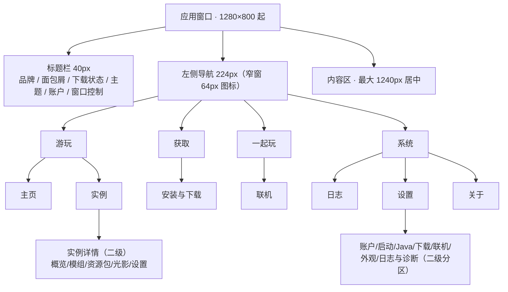
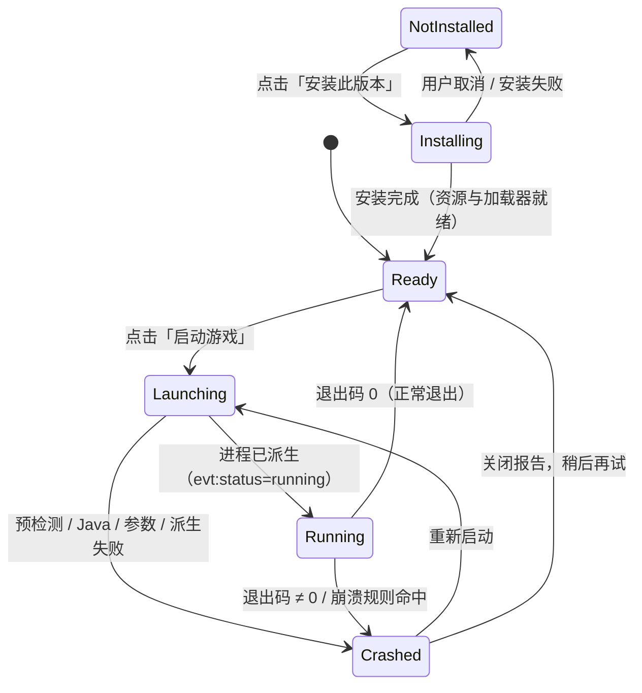
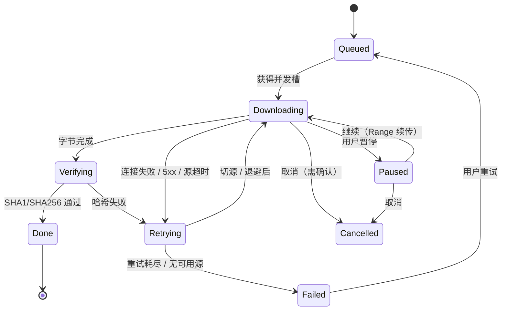
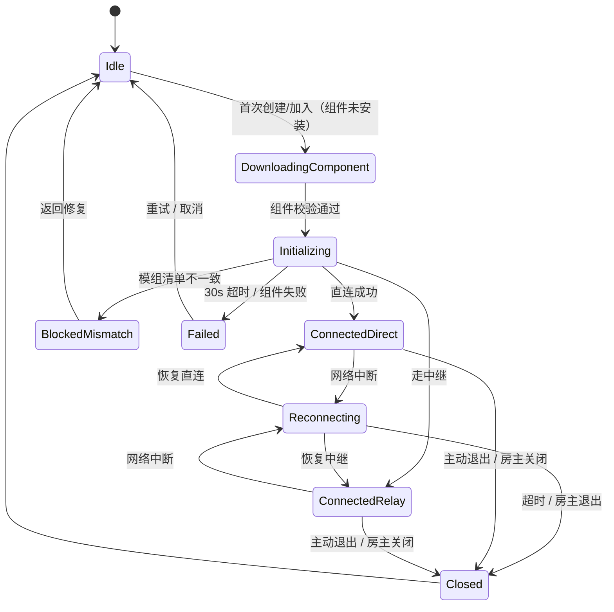

# Cubit Launcher · 界面设计规范与高保真原型

| 项 | 值 |
|---|---|
| 交付物 | `design/index.html`（单文件高保真原型）＋ 本文件（规范与组件说明） |
| 版本 | v0.1 · 2026-10-21 |
| 作者 | client-dev（桌面客户端 / 前端） |
| 上游依据 | [`10-feature-matrix.md`](../docs/research/10-feature-matrix.md)、[`40-architecture.md`](../docs/research/40-architecture.md) |
| 下游 | t10 渲染层实现；t5 壳层窗口参数；t6/t9 需要对齐的事件契约见 §7.3 |
| 范围 | 只做设计与静态原型，不含产品代码；clean-room，未复制 PCL2 / Mojang 的品牌、图标与界面资源 |

---

## 0. 交付说明

### 0.1 怎么打开

- **双击 `design/index.html`** 即可。单文件、无外部字体/图片/JS 依赖，离线可用。
- 深链示例：
  - `index.html#/home` 主页（默认）
  - `index.html#/instances` 实例列表
  - `index.html#/instances/detail` 实例详情
  - `index.html#/download` 安装与下载
  - `index.html#/link` 联机（房主 / 成员可切换）
  - `index.html#/logs` 日志与崩溃报告
  - `index.html#/settings` 设置
  - `index.html#/settings/account` 设置 · 账户
  - `index.html#/about` 关于
  - `index.html#/components` 设计规范 / 组件与状态（仅设计稿）
- 主题：右上角月亮 / 太阳按钮，或「设置 → 外观」。也可以用 `index.html?theme=dark#/home` 强制深色。
- **原型控制**：标题栏的烧瓶按钮可切换「启动按钮状态」「主页状态（正常/加载/空/错误）」「主题」，仅用于评审，不随产品发布。

### 0.2 原型已覆盖的页面与状态

| 页面 | 已覆盖 |
|---|---|
| 主页 | 正常、加载骨架、空（首次启动）、读取错误；启动按钮 6 态（未安装/就绪/安装中/启动中/运行中/崩溃）；最近实例、账户、联机、下载卡片 |
| 实例列表 | 正常 7 行（含中文/全角/长名）、当前实例、异常实例、筛选条、搜索、视图切换、空/加载/错误留位 |
| 实例详情 | 概览、模组（冲突横幅、启停开关、禁用行）、资源包、光影、实例设置；异常实例可从列表进入 |
| 安装与下载 | 原版 / Forge / NeoForge / Fabric / 整合包 5 种表单；磁盘预检；实时进度（总量/速度/剩余/当前文件/源）、暂停/继续、任务队列（等待/下载/校验/失败/完成） |
| 联机 | **房主**（邀请码、成员、NAT/中继/延迟、关闭房间、LAN 开放提示）与**成员**（已加入、中继提示、退出、加入另一房间表单）两种；实例一致性检查 |
| 设置 | 账户、启动、Java、下载、联机、外观、日志与诊断 7 个分区；自动保存状态；主题切换 |
| 日志 | 级别筛选、搜索、暂停/自动滚动、错误行、崩溃分析侧栏、会话信息、日志文件 |
| 关于 | 版本/更新、运行环境、开源许可、法务边界、规范页入口 |
| 对话框 | 崩溃报告（可复制/打开日志）、删除实例（列出存档）、原型说明 |
| 规范页 | 色板、字阶、间距/圆角/阴影、按钮矩阵、表单、反馈、容器、启动 6 态、下载 6 态、错误文案正反例、页面空/加载/错误示例 |

辅助评审截图位于 `design/preview/`（见 §8.2）。

### 0.3 原型没有做什么

- 不连接 IPC、不读写磁盘、不启动游戏、不登录账户；所有写操作以 Toast 或对话框演示，文案明确标注「原型/设计稿」。
- 联机房间为静态示意，不包含真实 EasyTier sidecar；设置在原型中不会持久化（主题除外）。
- 设计稿包含的开发用页面（`#/components`）与原型控制面板，**不得进入产品构建**。
- 不含 P1/P2：自定义强调色、紧凑密度、皮肤/披风、备份、Mod 在线更新、自定义主页等；界面中涉及处均标注 P1 或保持只读。

---

## 1. 信息架构与页面清单

### 1.1 全局结构



- **只有两层导航**：一级为左侧 7 个入口；二级为实例详情的标签页、设置页的分区。不再加第三层。
- 全局上下文（账户、下载任务、联机房间）在标题栏与主页右栏始终可见，避免用户为了看进度离开当前页。
- 「安装与下载」同时承载“安装配置”和“任务队列”，因为这两个任务在时序上不可分割；不拆成两个一级页。

### 1.2 导航规则

| 规则 | 说明 |
|---|---|
| 当前项 | 左侧高亮 + 3px 品牌绿指示条；实例详情归属于「实例」，设置分区归属于「设置」 |
| 返回 | 实例详情顶部有「← 实例」；`Alt + ←` 等价浏览器后退。返回列表保留滚动位置与筛选条件 |
| 深链 | `/settings/:section` 可直达账户/Java/诊断；实例详情路由 `/instances/:id`，原型用 `detail` 占位 |
| 窗口 | 最小 1024×700；≤1000px 左栏折叠为 64px 图标栏；≤860px 详情与设置单列；不支持手机布局 |
| 默认页 | 已安装实例：主页；空目录：主页空状态（引导安装/导入/选择目录） |
| 全局快捷键 | `Ctrl + ,` 设置；`Esc` 关闭对话框 / 收起原型面板；`Alt + ←` 返回 |
| 未保存 | 设置自动保存（500ms 防抖）；路径输入在失焦/回车时提交；破坏性操作必须二次确认 |
| 遮罩 | 对话框只用于“需要决策/不可逆”的场景；普通异步反馈用内联提示条与 Toast |

### 1.3 页面清单、核心任务与状态

| # | 页面 / 路由 | 核心任务 | 主要动作 | 空状态 | 加载态 | 错误态 |
|---|---|---|---|---|---|---|
| 1 | 主页 `/home` | 选中最近实例并启动 | 启动/安装、打开文件夹、切换实例、导入整合包、安装版本、进入联机、查看下载 | 无实例：安装第一个版本 / 导入整合包 / 选择 `.minecraft`；三张能力卡片 | 英雄卡 + 3 张实例卡 + 右栏骨架，≤1.5s 可交互 | 顶部内联横幅「读取实例列表时出错」+ 重新读取 / 选择目录 / 查看日志；不整页白屏 |
| 2 | 实例 `/instances` | 找到并管理实例 | 搜索、按加载器筛选、排序、新建、导入、启动、详情、修复、打开目录 | 无实例：与首页空状态一致；筛选无结果：「没有匹配的实例」+ 清除筛选 | 表头 + 行骨架；扫描进度（>3s 显示“正在扫描…”） | 扫描失败横幅 + 重试；单实例损坏按行标记，不拖垮整表 |
| 3 | 实例详情 `/instances/:id` | 调整该实例并启动；管理资源 | 启动、打开文件夹、重命名、修复、删除；模组搜索/启停/冲突处理；资源包/光影；实例级 Java/内存/隔离/参数 | 模组 0：拖入安装；资源包/光影 0：拖入 + 打开目录；无存档 | 详情骨架；模组分批扫描进度；保存中状态 | 实例不存在/被删除：返回实例列表；版本 JSON 损坏：启动按钮改为「需要修复」；保存失败：字段下方内联错误 + 重试 |
| 4 | 安装与下载 `/download` | 选择版本并安装；监控所有下载 | 选类型/版本/加载器、命名实例、开始安装；暂停/继续/取消/重试；查看日志；打开下载目录 | 队列空：显示“暂无任务”+ 去安装 | 版本清单加载骨架；安装器运行中显示阶段与日志入口 | 清单拉取失败：重试 / 换源；组合不可用：控件禁用并说明；磁盘不足：预检拦截；任务失败：行内重试/换源 |
| 5 | 联机 `/link` | 创建/加入房间，进入同一世界 | 房主：复制邀请码、管理成员、启动、关闭；成员：加入/退出、复制房主地址、查看差异；设置中继 | 未启用联机：说明 + 启用按钮；无房间：创建/输入邀请码 | 下载联机组件、初始化/组网中（阶段 + 计时 + 取消） | 邀请码无效/过期、组件失败、NAT 超时、实例不一致（列出差异并阻断）、房主关闭（5s 内提示） |
| 6 | 日志 `/logs` | 定位失败原因、导出诊断 | 级别/模块/关键词筛选、暂停/自动滚动、查看崩溃报告、复制报告、打开日志/导出诊断包 | 当前无日志：说明 + 打开日志目录 | 首次读取/切换会话的加载态；大日志截断提示 | 日志目录不可读：错误 + 重试；崩溃分析失败：降级显示“未能分析”+ 原始日志入口 |
| 7 | 设置 `/settings` | 配置启动器并即时生效 | 账户切换、内存/窗口、Java 选择、下载源/并发/限速、联机开关/中继、主题、日志级别/诊断 | —（设置永不空白；未检测到 Java 显示引导） | 设置读取骨架；保存中；Java 扫描中 | 保存失败：内联“未保存，重试”；Java 路径失效：该行标红并给“重新选择”；数据目录迁移需确认 |
| 8 | 关于 `/about` | 版本、更新、法务与许可 | 检查更新、切换通道、打开数据目录、复制系统信息、查看许可/隐私 | — | 检查更新中（按钮 spinner） | 更新检查失败：内联“暂时无法检查更新”，不阻塞；便携模式自动更新关闭并说明 |
| 9 | 首次启动 `/welcome`（主页态） | 从零建立可玩环境 | 选择目录 / 安装版本 / 导入整合包 / 登录（可跳过） | 同主页空状态；不强制登录 | 目录探测骨架 | 目录不可写/无权限：说明 + 换目录；不产生半文件 |
| D | 设计规范 `/components` | 评审与实现对照 | 锚点跳转、打开对话框、查看状态矩阵 | — | — | — |

> “空 / 加载 / 错误”不是可选项：t10 的验收会逐页检查这三种状态是否可从真实 IPC 触发，而不是只检查正常路径。

---

## 2. 视觉规范

### 2.1 视觉取向（对应任务第 6 点）

- **参考 PCL2 的“克制与高信息密度”**：一屏尽量多给有用信息；按钮不堆图标；不用大面积插画；状态用文字 + 小色块，而不是装饰。
- **不复制 PCL2 的品牌与图标**：不采用其 Logo、方块图标、配色命名或页面骨架；所有图标为本设计自绘的 24px 线性 SVG。
- **微软商店 / Fluent 的现代感**：白色/石墨表面、1px 描边、8px 圆角、40px 自定义标题栏、Segoe UI Variable、克制的阴影；强调色只出现在主操作、选中与连接成功。
- **品牌占位**：产品名 **Cubit Launcher**、立方体标记、强调色 **Verdant #0C7A57** 均为占位，可在不改布局的前提下替换。设计目标是“看起来像一个可信的 Windows 工具”，而不是“像某个现有启动器”。
- **暗色不是反色**：暗色下提高表面层级差、降低阴影、把强调色提亮到 `#3FCB92`，并让强调色上的文字变深（`#06231A`），保证 ≥4.5:1。

### 2.2 色板（明 / 暗）

> 对比度按 WCAG 2.1 相对亮度计算（sRGB），正文要求 ≥4.5:1，非文本 UI 边界建议 ≥3:1。实测值见附录 A。

#### 表面与文字

| Token | 浅色 | 深色 | 用途 |
|---|---|---|---|
| `--bg` | `#F4F6F8` | `#0F1316` | 内容区画布 |
| `--surface` | `#FFFFFF` | `#171C20` | 卡片、标题栏、左栏、对话框 |
| `--surface-2` | `#F7F9FA` | `#1D2328` | 次级底、输入悬停、表头 |
| `--surface-3` | `#EEF1F4` | `#252C32` | 悬停、轨道、分段底 |
| `--border-subtle` | `#E4E8EC` | `#262E34` | 卡片分隔、表格线 |
| `--border` | `#D7DDE3` | `#313A42` | 输入/控件描边 |
| `--border-strong` | `#B9C2CB` | `#46525C` | 悬停描边、强调边界 |
| `--text` | `#161B1F` | `#E9EEF2` | 标题、主文字 |
| `--text-2` | `#5B6670` | `#A9B4BE` | 正文、说明 |
| `--text-3` | `#66717C` | `#8A969F` | 弱化信息、时间戳（仍达 AA） |
| `--text-disabled` | `#A3ADB6` | `#5C666F` | 禁用文字 |
| `--text-inverse` | `#F3F6F8` | `#0F1316` | 反色表面上的文字 |

#### 品牌与语义色

| Token | 浅色 | 深色 | 用途 |
|---|---|---|---|
| `--accent` | `#0C7A57` | `#3FCB92` | 主按钮、进度、选中指示 |
| `--accent-hover` | `#0A6749` | `#58D8A4` | 主按钮悬停 |
| `--accent-active` | `#08553C` | `#2FB681` | 主按钮按下 |
| `--accent-text` | `#0A6B4C` | `#5BD9A5` | 链接、选中文字、幽灵强调 |
| `--accent-subtle` | `#E6F4EE` | `#14291F` | 选中底、邀请码底、提示底 |
| `--on-accent` | `#FFFFFF` | `#06231A` | 主按钮文字 |
| `--success` / `-bg` / `-text` | `#157A46` / `#E8F6EE` / `#12703F` | `#4ECB8B` / `#12261B` / `#7FE0B0` | 就绪、已完成、检查通过 |
| `--warning` / `--warning-solid` / `-bg` / `-text` | `#8A5300` / `#B7791F` / `#FFF6E5` / `#8A5300` | `#E6A93C` / `#C98A00` / `#2A2113` / `#F0C36A` | 需修复、暂停、中继提示 |
| `--danger` / `-bg` / `-text` | `#B3261E` / `#FDEDEB` / `#A32019` | `#F07A72` / `#2B1615` / `#FF9A93` | 失败、删除、异常退出 |
| `--info` / `-bg` / `-text` | `#1B5CBF` / `#EAF1FD` / `#1B5CBF` | `#78A9FF` / `#14203A` / `#9CC0FF` | 校验中、中性提示、中继徽章 |
| `--loader-forge` / `-bg` | `#8A4B12` / `#FBF0E4` | `#E8B77E` / `#332316` | Forge 标签 |
| `--loader-neo` / `-bg` | `#6C3B8A` / `#F4ECFA` | `#CBA6E8` / `#2B2035` | NeoForge 标签 |
| `--loader-fabric` / `-bg` | `#146C94` / `#E7F3F8` | `#86CBE8` / `#152B34` | Fabric 标签 |
| `--loader-vanilla` / `-bg` | `#4B5563` / `#EEF1F4` | `#C3CCD4` / `#262E34` | 原版标签 |
| `--loader-pack` / `-bg` | `#0B6B5B` / `#E4F4F0` | `#7BD9C4` / `#122A26` | 整合包标签 |

**用色规则**：

1. 一个视图最多 1 个实心主按钮；主按钮只用于“启动 / 安装 / 保存 / 加入 / 复制邀请码”这类主链动作。
2. 强调绿不用于装饰性标题；页面标题、卡片标题一律使用 `--text`。
3. 红色只表示真实失败与删除；普通警告用琥珀色（需修复、暂停、中继延迟）。
4. 状态永远同时有文字或图标，不依赖颜色区分；连接成功/中继/直连均带文字徽章。
5. 图表/进度不使用彩虹色；进度统一强调绿，成功完成才转语义绿。

### 2.3 字阶

| 样式 | 字号/行高 | 字重 | 使用场景 |
|---|---|---|---|
| Display | 28 / 34 | 600 | 空状态主标题、关于页品牌（极少使用） |
| H1 | 22 / 28 | 600 | 页面标题（主页欢迎语、实例、设置…） |
| H2 | 17 / 24 | 600 | 区块标题、对话框标题附近的次级标题 |
| H3 | 15 / 22 | 600 | 卡片标题、区块小标题 |
| Body-L | 14 / 22 | 400 | 对话框描述、需要阅读的说明 |
| Body | 13 / 20 | 400 | 全站正文、表格文字 |
| Label | 13 / 18 | 600 | 表单标签、按钮 |
| Caption | 12 / 16 | 400 | 辅助说明、路径、时间 |
| Micro | 11 / 14 | 500 | 分组标签、表头、徽章（字距 +0.02em） |
| Mono | 12 / 20 | 400 | 日志、路径、版本号、邀请码 |
| Stat | 18 / 24 | 600 | 概览数字（tabular-nums） |

- 字体栈：`"Segoe UI Variable Text", "Segoe UI", "Microsoft YaHei UI", "Microsoft YaHei", system-ui, sans-serif`；等宽：`"Cascadia Mono", "Cascadia Code", Consolas, monospace`。
- 只使用 400 / 600 两个字重。中文不使用 italic；英文产品名不用全部大写。
- 所有数字（进度、大小、速度、计时）加 `font-variant-numeric: tabular-nums`，避免宽度跳动。
- 长名称：`text-overflow: ellipsis` + 单行；必须有 `title` 或悬浮提示显示全名。路径使用中间省略，保留盘符与末尾目录。

### 2.4 间距、布局与栅格

- 4px 基准：`4 / 8 / 12 / 16 / 20 / 24 / 32 / 40 / 48`。
- 页面：`padding: 24px 32px 48px`；窄窗 `20px 24px 40px`；内容最大宽度 1240px 居中。
- 左栏 224px（≤1000px 折叠 64px）；标题栏 40px；内容卡片间距 12–14px；卡片内边距 14–20px。
- 表格行 48px（紧凑 40px，P1）；表头 32px；表单控件 32px（大 40，小 28，微型 24）。
- 主页两栏：主列 `minmax(0,1fr)` + 右栏 300px；≤1100px 右栏 270；≤1000px 右栏改为两列并落到主列下方。
- 系统状态 3 项：≤1380px 变两列（第三项换行），≤640px 单列；实例卡与快速开始同理。
- 实例卡三列（≤1100 两列，≤860 两列，≤640 单列）；不强行压缩文字，宁可换行。
- 文本可读宽度：说明段落最大 720px；对话框正文最大 620px。
- 设计面向 100% / 125% / 150% Windows 缩放；最小 1024×700，推荐 1280×800。

### 2.5 圆角、描边、阴影

| Token | 值 | 用途 |
|---|---|---|
| `--radius-xs` | 4px | 徽章、标签、键帽 |
| `--radius-sm` | 6px | 按钮、输入框、下拉、步进器 |
| `--radius-md` | 8px | 卡片、横幅、表格容器、提示 |
| `--radius-lg` | 12px | 对话框、邀请码区域（大面板） |
| `--radius-pill` | 999px | 分段、开关、筛选 chip、进度条 |

- **描边优先**：默认卡片只有 1px `--border-subtle`，不用阴影。阴影只用于浮层与交互悬停：
  - `--shadow-1`（1–2px）卡片悬停、轻浮层；
  - `--shadow-2`（8–24px）任务卡、Toast、下拉菜单；
  - `--shadow-3`（24–64px）对话框、原型面板。
- 暗色下阴影更深、更弱；层级主要靠表面亮度差（`surface` → `surface-2` → `surface-3`）。
- 不使用 2px 以上彩色描边做大面积装饰；焦点环是唯一允许的 2px 外环。

### 2.6 动效

| Token | 值 | 用途 |
|---|---|---|
| `--dur-1` | 80ms | hover、按下、颜色变化 |
| `--dur-2` | 140ms | 开关、展开、分段切换 |
| `--dur-3` | 220ms | 页面淡入、对话框进入 |
| `--dur-progress` | 1600ms | 进度流光（装饰） |
| `--ease` | `cubic-bezier(.2,0,0,1)` | 标准 |
| `--ease-out` | `cubic-bezier(.05,.7,.1,1)` | 进入、Toast |

- 页面进入：透明度 0→1 + 位移 3px，220ms；不做大幅滑动。
- 进度条：宽度 350ms 过渡；数字更新直接跳变，不做数字滚动动画（避免读数困难）。
- 加载：spinner 800ms 线性；骨架 1.4s 循环；进度流光 1.6s。
- 尊重 `prefers-reduced-motion`；设置中「减少动效」关闭所有装饰动画。
- 只有“正在发生”的状态才允许持续动画（spinner、运行中脉冲）；静态页面不得有呼吸装饰。

### 2.7 图标与品牌

- 统一 24×24 网格、1.6px 线性描边、圆角端点与连接；显示尺寸 14 / 16 / 18 / 20，按场景取用。
- 填充仅用于 Play 三角形与状态圆点；导航选中不改成面性图标，而是加背景与指示条。
- 图标全部自绘内联 SVG，无第三方图标库、无 Minecraft/PCL 资源。
- 产品标记：等轴立方体线稿（`#i-logo`），用作占位品牌；实例图标是同一立方体的加载器配色变体（Forge 琥珀、Neo 紫、Fabric 蓝、原版石墨、整合包青），不复制游戏内方块贴图。
- 品牌名「Cubit」为占位；实现时集中到 `brand.ts`（名称、版本、图标路径），便于替换。

### 2.8 可访问性基线

- 正文对比度 ≥4.5:1；`text-3` 在浅色画布上 4.60:1，深色表面 5.68:1（见附录 A）。
- 焦点：`:focus-visible` 2px 实线 + 2px offset；不用 `outline:none` 除非同时给替代环。
- 控件真实语义：按钮用 `<button>`，开关 `role="switch"` + `aria-checked`，标签页 `role="tab"`/`aria-selected`，进度 `role="progressbar"` + `aria-valuenow`，Toast 区 `aria-live="polite"`。
- 触达目标：常规 32px，密集表格内的图标按钮至少 24×24；不把纯图标当唯一标签（必须有 `aria-label` + `title`）。
- 键盘：所有交互可 Tab 到达；`Esc` 关闭浮层；对话框实现焦点圈定与返回原焦点（原型只做返回焦点，t10 需补 focus trap）。
- 减少动效、高对比度（Windows 强制色）下不依赖背景图；进度/状态有文本。
- 中文文案不使用全大写英文；技术码用等宽字体并放在详情，不作为标题。

### 2.9 完整设计令牌（可直接落到 `tokens.css`）

```css
:root {
  color-scheme: light;
  --font-sans: "Segoe UI Variable Text", "Segoe UI", "Microsoft YaHei UI", "Microsoft YaHei", system-ui, sans-serif;
  --font-display: "Segoe UI Variable Display", "Segoe UI Variable Text", "Segoe UI", "Microsoft YaHei UI", sans-serif;
  --font-mono: "Cascadia Mono", "Cascadia Code", "Consolas", "Courier New", monospace;

  --bg: #F4F6F8;
  --surface: #FFFFFF;
  --surface-2: #F7F9FA;
  --surface-3: #EEF1F4;
  --surface-sunken: #EDF0F3;
  --surface-inverse: #1B2227;
  --border-subtle: #E4E8EC;
  --border: #D7DDE3;
  --border-strong: #B9C2CB;
  --overlay: rgba(12, 18, 24, .42);
  --accent-glow: rgba(12, 122, 87, .055);

  --text: #161B1F;
  --text-2: #5B6670;
  --text-3: #66717C;
  --text-disabled: #A3ADB6;
  --text-inverse: #F3F6F8;

  --accent: #0C7A57;
  --accent-hover: #0A6749;
  --accent-active: #08553C;
  --accent-text: #0A6B4C;
  --accent-subtle: #E6F4EE;
  --accent-subtle-2: #D5EDE3;
  --accent-ring: rgba(12, 122, 87, .28);
  --on-accent: #FFFFFF;
  --focus: #0C7A57;

  --success: #157A46; --success-bg: #E8F6EE; --success-border: #BFE6CF; --success-text: #12703F;
  --warning: #8A5300; --warning-bg: #FFF6E5; --warning-border: #F0D9AE; --warning-text: #8A5300; --warning-solid: #B7791F;
  --danger: #B3261E; --danger-bg: #FDEDEB; --danger-border: #F3C9C5; --danger-text: #A32019; --danger-solid: #B42318; --on-danger: #FFFFFF;
  --info: #1B5CBF; --info-bg: #EAF1FD; --info-border: #C6D8F7; --info-text: #1B5CBF;

  --loader-vanilla: #4B5563; --loader-vanilla-bg: #EEF1F4;
  --loader-forge: #8A4B12; --loader-forge-bg: #FBF0E4;
  --loader-neo: #6C3B8A; --loader-neo-bg: #F4ECFA;
  --loader-fabric: #146C94; --loader-fabric-bg: #E7F3F8;
  --loader-pack: #0B6B5B; --loader-pack-bg: #E4F4F0;

  --shadow-1: 0 1px 2px rgba(16,24,32,.06), 0 1px 1px rgba(16,24,32,.04);
  --shadow-2: 0 8px 24px rgba(16,24,32,.10), 0 2px 6px rgba(16,24,32,.05);
  --shadow-3: 0 24px 64px rgba(12,18,24,.18), 0 4px 12px rgba(12,18,24,.08);

  --radius-xs: 4px; --radius-sm: 6px; --radius-md: 8px; --radius-lg: 12px; --radius-pill: 999px;
  --dur-1: 80ms; --dur-2: 140ms; --dur-3: 220ms; --dur-progress: 1600ms;
  --ease: cubic-bezier(.2, 0, 0, 1);
  --ease-out: cubic-bezier(.05, .7, .1, 1);

  --titlebar-h: 40px;
  --rail-w: 224px;
  --row-h: 48px;
  --switch-knob: #FFFFFF;
}

[data-theme="dark"] {
  color-scheme: dark;
  --bg: #0F1316;
  --surface: #171C20;
  --surface-2: #1D2328;
  --surface-3: #252C32;
  --surface-sunken: #12171A;
  --surface-inverse: #E9EEF2;
  --border-subtle: #262E34;
  --border: #313A42;
  --border-strong: #46525C;
  --overlay: rgba(0, 0, 0, .60);
  --accent-glow: rgba(63, 203, 146, .06);

  --text: #E9EEF2;
  --text-2: #A9B4BE;
  --text-3: #8A969F;
  --text-disabled: #5C666F;
  --text-inverse: #0F1316;

  --accent: #3FCB92;
  --accent-hover: #58D8A4;
  --accent-active: #2FB681;
  --accent-text: #5BD9A5;
  --accent-subtle: #14291F;
  --accent-subtle-2: #1B3A2C;
  --accent-ring: rgba(63, 203, 146, .28);
  --on-accent: #06231A;
  --focus: #6FE3B2;

  --success: #4ECB8B; --success-bg: #12261B; --success-border: #245B3D; --success-text: #7FE0B0;
  --warning: #E6A93C; --warning-bg: #2A2113; --warning-border: #5A4520; --warning-text: #F0C36A; --warning-solid: #C98A00;
  --danger: #F07A72; --danger-bg: #2B1615; --danger-border: #5C2B28; --danger-text: #FF9A93; --danger-solid: #C0392B;
  --info: #78A9FF; --info-bg: #14203A; --info-border: #2C4670; --info-text: #9CC0FF;

  --loader-vanilla: #C3CCD4; --loader-vanilla-bg: #262E34;
  --loader-forge: #E8B77E; --loader-forge-bg: #332316;
  --loader-neo: #CBA6E8; --loader-neo-bg: #2B2035;
  --loader-fabric: #86CBE8; --loader-fabric-bg: #152B34;
  --loader-pack: #7BD9C4; --loader-pack-bg: #122A26;

  --shadow-1: 0 1px 2px rgba(0,0,0,.40);
  --shadow-2: 0 10px 30px rgba(0,0,0,.50), 0 2px 6px rgba(0,0,0,.35);
  --shadow-3: 0 28px 72px rgba(0,0,0,.65), 0 6px 18px rgba(0,0,0,.40);
  --switch-knob: #07130E;
}
```

> 实现要求：组件样式只能引用变量；任何 `#RRGGBB` 只允许出现在 tokens 文件与品牌 SVG 中。主题切换只改 `<html data-theme>`，不重建 React 树。

---

## 3. 高保真原型说明（`design/index.html`）

### 3.1 结构

- 单文件：内联 `<style>`（令牌 + 组件 + 页面）和内联 `<script>`（路由、主题、状态演示），无外部请求。
- 图标：顶部隐藏的 `<svg><symbol>` 集合，页面内通过 `<use href="#i-…">` 复用。
- 视图：9 个 `<section class="view" data-view="…">`，hashchange 切换；深链与浏览器后退可用。
- 原型控制：标题栏 `<details>`，**虚线强调边框**，明确标注“仅用于设计评审，不随产品发布”。

### 3.2 交互演示

| 操作 | 行为 |
|---|---|
| 点「启动游戏」 | 就绪 → 启动中（阶段链）→ 运行中（计时）；「结束游戏」→ 就绪 |
| 烧瓶 → 启动状态 | 强制展示 6 种状态；崩溃态可打开崩溃报告 |
| 烧瓶 → 主页状态 | 正常 / 加载骨架 / 空 / 读取错误 |
| 主题按钮 / 设置 → 外观 | 浅色 / 深色 / 跟随系统；`localStorage` 记忆 |
| 联机 → 我是房主 / 我是成员 | 切换两套完整房间布局；成员侧显示中继与延迟 |
| 安装类型标签 | 原版 / Forge / NeoForge / Fabric / 整合包 表单切换 |
| 下载暂停 / 继续 | 任务卡、队列行、首页迷你任务、标题栏同步 |
| 模组开关 | 行状态、标签、已启用计数联动 |
| 日志级别 / 搜索 | 过滤控制台并更新“当前显示”行数 |
| 复制邀请码 / 报告 / 路径 | Clipboard API + `execCommand` 回退，Toast 反馈 |
| 对话框 | 遮罩/关闭按钮/Esc 关闭；返回原焦点 |

> 这些是**设计演示**，不是实现方案。正式实现不得用计时器伪造启动/下载状态，必须消费 IPC 事件（§7.3）。

---

## 4. 交互说明

### 4.1 启动按钮状态机（核心）

#### 状态图



`Blocked`（需要修复）不是第 7 个按钮状态，而是 **Ready 的派生门禁**：版本 JSON 损坏、Java 缺失且无法自动补齐、实例目录不可访问时，启动按钮转为「需要修复」，点击进入修复向导而不是进入 Launching。它必须由 `launch.status` 或预检测错误驱动，不允许 UI 自己猜。

#### 6 种可见状态

| 状态 | 按钮文案 | 外观 | 可点击 | 下方状态条 | 次操作 | 进入条件 |
|---|---|---|---|---|---|---|
| `not-installed` | **安装此版本** | 次按钮 + 下载图标 | 是 | “缺少版本文件，安装后才能启动” | 前往安装 | 版本 JSON/jar 缺失或损坏 |
| `ready` | **启动游戏** | 主按钮 + Play | 是 | 上次游玩 / 累计时长 | 查看日志、打开文件夹、更多 | 预检测通过 |
| `installing` | **正在准备…** | 主按钮 + spinner，禁用 | 否 | 阶段 + 进度条 + 取消 | 取消（删除半成品） | 首次补齐资源 / 安装加载器 |
| `launching` | **启动中…** | 主按钮 + spinner，禁用 | 否 | 四阶段 chip（预检测 / Java / 参数 / 进程） | 查看日志 | 参数已构造，等待进程 |
| `running` | **游戏运行中** | 强调底 + 脉冲点 | 是（仅提示） | 运行计时 + 查看日志 + 结束游戏 | 结束游戏（需确认） | 进程存活 |
| `crashed` | **重新启动** | 暖色底 + 刷新图标 | 是 | “游戏异常退出（返回码 N）”+ 查看报告 | 查看报告、打开日志 | 非 0 退出 / 启动失败 |

#### 规则与边界

1. **事件驱动，状态唯一**：`launch.status` 是唯一真相；UI 不得因为“点击成功”就切到 running。开始请求返回只代表已排队。
2. **立即反馈**：点击后 ≤100ms 进入 `launching` 并禁用按钮，避免双击产生两个进程。
3. **退出码 0 永不崩溃**：正常退出回 `ready`，只留一条“游戏已退出”Toast；不弹崩溃报告（P0-13 负向用例）。
4. **崩溃报告异步**：`crashed` 可先于报告生成；报告未就绪时「查看报告」显示 spinner，≤10s 后可用；超时降级为“打开日志”。
5. **启动失败 vs 游戏崩溃**：两者都映射到 `crashed` 视觉，但文案不同：
   - 启动前失败：“未能启动游戏” + 原因（Java/参数/文件）+ 修复/重试；
   - 进程退出：“游戏异常退出（返回码 N）” + 报告。
6. **结束游戏需要确认**：运行中点击“结束游戏”弹确认（会丢失未保存进度），确认后调用 `launch.stop`；不提供无确认的一键杀进程。
7. **窗口重载/切换实例**：重新查询状态；如果已有运行会话，进入任何页面都要能看到“运行中”胶囊，不可重复启动。
8. **启动器退出**：用户关闭启动器时若游戏仍在运行，询问“游戏会继续运行 / 同时结束游戏”，不得默认杀进程。
9. **运行中计时**：从进程派生事件开始计时，不采用客户端点击时间；跨页面保持。
10. **安装中取消**：清理 `versions/<目标>` 半成品与临时文件，不能留下“看起来装好了”的空目录。

建议契约（待 t6 对齐）：

```ts
// 建议新增的 UI 最小事件集；不修改已冻结的通道命名规则
api.launch.status({ instanceId })  // -> { state, sessionId?, startedAt?, exitCode?, reportReady? }
api.launch.start({ instanceId })   // -> { sessionId }
api.launch.stop({ sessionId })     // -> { ok: true }
onEvent('mc:launch:evt:status', ({ instanceId, state, startedAt, exitCode }) => …)
onEvent('mc:launch:evt:stage',  ({ instanceId, stage, detail }) => …)
onEvent('mc:launch:evt:output', ({ sessionId, line }) => …)   // 已存在，节流
onEvent('mc:launch:evt:exited', ({ sessionId, exitCode, reportId? }) => …)
```

### 4.2 下载反馈与状态机

#### 状态图



#### 必须展示的反馈

| 字段 | 规则 | 示例 |
|---|---|---|
| 总量 / 进度 | 已完成 / 总量（1 位小数，GB），百分比取整；进度条宽度与 aria-valuenow 同步 | `1.8 / 3.2 GB · 56%` |
| 速度 | 3 秒滑动平均；事件间隔不足 1s 显示 `—`；单位 MB/s（1024 进制，标注 MB） | `12.4 MB/s` |
| 剩余时间 | `剩余 = (总量 − 已完成) / 速度`；<60s 取整秒；<1h 显示“约 X 分 Y 秒”；>1h 显示“约 X 小时 Y 分”；未知显示“计算中” | `约 2 分 10 秒` |
| 当前文件 | 等宽 11px，中间省略，保留文件名；hover 显示完整路径；不换行撑高 | `…forge-1.20.1-47.4.20-universal.jar` |
| 阶段 | 下载支持库 → 下载资源 → 校验 → 解压/安装加载器；校验中不能显示“已完成” | `正在下载支持库 · 312 / 612` |
| 源 | 显示当前源 + 自动切换次数；切换在日志与内联提示里说明原因 | `BMCLAPI · 已自动切换 1 次` |
| 并发 | 任务卡显示 8 并发；全局设置可改 | `8 并发` |
| 暂停 | 保留 `.part` 与已完成字节；继续使用 Range；按钮变“继续” | 状态徽章“已暂停” |
| 取消 | 二次确认；删除临时目录；不残留半文件；不影响其它任务 | “取消后将从断点丢弃，已下载的 1.8 GB 会删除” |
| 失败 | 显示原因 + 已重试次数 + 「重试 / 换源」 | “官方源连接超时（已重试 2 次）” |
| 完成 | 100% 且哈希通过才转成功；Toast + 任务行保留“已完成”；提供“启动游戏/打开文件夹” | “安装完成，可以启动游戏” |

#### 规则

1. **事件按任务 id 节流 100ms**（架构 §5.4）；UI 收到进度后做宽度过渡，但**不得在事件之间自增百分比**——停工就是停工。
2. **校验优先**：文件下载完不代表完成；校验失败自动重试 2 次，仍失败 `DOWNLOAD.HASH_MISMATCH`（retryable），绝不静默接受损坏文件。
3. **源熔断**：连续失败 3 次禁用该源并切到下一个；所有源不可用才报“已无可用下载源”。禁止无限重试。
4. **暂停语义**：暂停停止新请求并保留 `.part`；取消删除临时文件；继续必须校验已有字节的 Range 支持。
5. **预检**：开始前检查磁盘空间（需要 ≥ 下载量 × 1.2 + 解压余量）；空间不足拦截，给“清理缓存/打开目录”，不创建半文件。
6. **队列**：默认 8 并发；按主机限流；等待中的任务明示“队列第 N 位”；支持全部暂停。
7. **无障碍**：进度条 `role="progressbar"`，阶段变化通过 `aria-live="polite"` 播报，不逐帧播报。
8. **失败可恢复**：错误行必须提供“重试”；hash 失败给“重新下载”；源问题给“换源”；空间不足给“清理缓存”，且 `retryable` 决定是否自动重试。

### 4.3 联机：房主 / 成员

#### 状态图



#### 房主与成员的差异

| 维度 | 房主 | 成员 |
|---|---|---|
| 主操作 | 复制邀请码、启动游戏、关闭房间 | 输入邀请码/加入、启动游戏、退出房间 |
| 邀请码 | 大号等宽展示 + 复制按钮 | 加入表单输入，或已加入后的房间码展示 |
| 成员列表 | 可管理（P1）；显示本机标记、每个成员的 NAT/路径/延迟 | 只读；显示房主标记 |
| 网络建议 | “NAT 良好，朋友可直连；中继成员延迟略高” | “你正在通过社区节点中继，42ms；持续 >120ms 可换房主” |
| 关闭 | 二次确认，5s 内广播所有成员 | 退出即时，回到 Idle |
| 最后一步 | 进入世界后 `Esc → 对局域网开放`，否则成员看不到 | 多人游戏列表加入；看不到时用“直接连接”输入房主地址 |

#### 实例一致性门禁（差异化）

- 加入前在本地计算实例 `mods` 清单哈希（`mods` 提供 `computeModsetHash()`）；比对房主/房间公告的哈希。
- 不一致时**阻断加入**，列出差异：缺失模组、额外模组、版本不匹配；提供“打开实例详情 / 复制差异 / 仍然尝试（需要房主允许，默认关闭）”。
- 检查失败不能表现为“转圈”；错误码 `LINK.MODSET_MISMATCH` + 可读说明。
- 成功后房间卡片显示“检查通过：实例版本 / 模组清单 / Java”三项，作为可解释证据。

#### 网络与状态文案

- 只展示真实值：`NAT 类型`（良好 / 端口限制型 / 对称型）、`连接方式`（直连 / 中继）、`ping`（毫秒、等宽）。
- 中继必须明示“正在通过社区节点中继”，不美化延迟；直连不标“极速”等营销词。
- 组网中显示阶段与已用时间（“正在初始化虚拟网络 · 8s”），30s 超时给重试/取消；邀请码错误立即报错，不无限转圈。
- 房主退出/房间关闭：5s 内所有成员收到“房间已关闭”，成员状态回到 Idle；断线重连时显示“连接中断，正在重连…”，恢复后 Toast“已重新连接”。
- 房间码不写日志；联机组件的哈希/签名在执行前校验；sidecar 仅监听 `127.0.0.1`。

### 4.4 错误提示与文案规范

#### 三句话结构

> **发生了什么**（事实）→ **影响是什么**（可选）→ **下一步能做什么**（必须有）

- 中文、短句、动词开头；不使用“您”；一句话 ≤40 个汉字。
- 标题不写“失败！！！”；不用“未知错误，请联系管理员”；不把英文异常作为首屏标题。
- 技术信息（错误码、traceId、路径、异常原文）放在详情/折叠区，使用等宽字体；仍可复制。
- 可恢复错误提供主操作（重试/选择/下载/打开日志）；不可恢复错误提供次操作（打开目录/复制报告）。
- Toast 最多两行、最多一个动作（或纯信息）；需要决策的用对话框；页面级问题用内联 Banner。
- 语气中性、不指责用户、不卖萌；严重但不吓人：“游戏异常退出”而非“崩溃了！”。

#### 展示位置矩阵

| 场景 | 组件 | 例子 |
|---|---|---|
| 异步操作成功/轻提示 | Toast 3.2s | “邀请码已复制” |
| 页面局部失败但其余可用 | 内联 Banner | “读取实例列表时出错” + 重新读取 |
| 表单字段错误 | 字段下方 `field__error` | “地址不能包含空格。请检查后重试。” |
| 不可逆操作 | 对话框 | 删除实例（列出存档）/ 结束游戏 / 关闭房间 |
| 崩溃/需要查看诊断 | 对话框或日志侧栏 | 崩溃报告（可复制纯文本） |
| 模块故障（不影响其它模块） | 页面级 Banner | “模组管理暂不可用：MODS.ACTIVATION_FAILED” + 重新加载 |
| 应用级致命 | 对话框 + 日志 | “启动器遇到无法继续的问题”（带 traceId/重启/导出） |

#### 错误码与文案映射

> 带 `*` 的为 UI 建议新增；其余沿用架构 §9.3 的 `userMessage` 基线（`FS.NO_SPACE` 见架构 §11.4 的 ENOSPC 映射）。所有新码必须在 `ERROR_CODES` 合并窗口内补充，t10 不得自造字符串。

| code | 用户文案（标题/正文） | 主操作 | 次操作 | 展示 |
|---|---|---|---|---|
| `AUTH.NO_ACCOUNT` | 还没有登录 Microsoft 账号 | 登录 | 使用离线账户 | 内联 |
| `AUTH.INVALID_GRANT` | 登录已过期，请重新登录 | 重新登录 | 查看日志 | 内联/Banner |
| `AUTH.XSTS_NO_XBOX` | 该账号没有 Xbox 档案，请先在 xbox.com 创建 | 打开 xbox.com | 切换账户 | 对话框 |
| `AUTH.XSTS_CHILD` | 未成年账号需要家长在 Microsoft 家庭中授权 | 查看帮助 | 切换账户 | 对话框 |
| `NET.OFFLINE` | 网络不可用，请检查连接或代理 | 重试 | 检查代理设置 | Banner |
| `NET.HTTP_5XX` | 服务器暂时不可用（已重试 3 次） | 重试 | 换下载源 | Banner |
| `NET.MIRROR_INVALID` | 镜像地址不合法或缺少必要路径 | 修改镜像 | 恢复自动 | 字段错误 |
| `DOWNLOAD.HASH_MISMATCH` | 文件校验失败，将重新下载 | 重试 | 查看日志 | 任务行 |
| `DOWNLOAD.NO_SOURCE*` | 已无可用下载源 | 换源 | 查看日志 | 任务行 |
| `JAVA.NOT_FOUND` | 找不到可用的 Java 运行时 | 下载 Java 21 | 选择已安装的 Java | 对话框 |
| `JAVA.VERSION_MISMATCH` | 该版本需要 Java {n}，当前是 {m} | 切换 Java | 下载 Java {n} | 内联 |
| `JAVA.PROBE_TIMEOUT` | Java 检测超时（可能是安装损坏） | 重新扫描 | 手动指定路径 | 设置行 |
| `VERSION.NOT_FOUND` | 游戏版本不存在 | 返回版本列表 | 刷新清单 | 内联 |
| `VERSION.INHERIT_CYCLE` | 版本继承链存在循环 | 重新安装/修复 | 查看日志 | 对话框 |
| `MODS.INCOMPATIBLE` | {mod} 需要 {range}，当前 {ver} | 禁用冲突模组 | 查看依赖 | 实例 Banner |
| `LAUNCH.EXIT_NONZERO` | 游戏异常退出（返回码 {code}） | 查看报告 | 重新启动 | 崩溃对话框 |
| `LAUNCH.OOM` | 内存不足，试试把最大内存调到 {n} MB | 调整内存 | 打开报告 | 崩溃对话框 |
| `FS.NO_SPACE` | 磁盘空间不足，还差 {n} GB | 清理缓存 | 打开目录 | Banner |
| `FS.PATH_ESCAPE` | 非法的文件路径 | 重新选择 | 查看日志 | 字段错误 |
| `INTERNAL` | 发生了未预期的错误（{traceId}） | 重试 | 导出诊断包 | Banner/对话框 |
| `KERNEL.MODULE_FAILED` | 模块 {id} 启动失败，相关功能不可用 | 重新加载模块 | 查看日志 | 页面 Banner |
| `LINK.CODE_INVALID*` | 邀请码不正确或已过期 | 重新输入 | 从剪贴板粘贴 | 字段错误 |
| `LINK.MODSET_MISMATCH*` | 双方的模组清单不一致，暂时不能加入 | 查看差异 | 返回修复 | 对话框 |
| `LINK.SIDECAR_FAILED*` | 联机组件未能启动 | 重新下载组件 | 仅玩单机 | 对话框 |
| `LINK.TIMEOUT*` | 连接超时，可能是网络或中继不可用 | 重试 | 更换中继节点 | Banner |

**文案反例**（规范页也有对照）：

- ✗ “启动失败：Error: spawn ENOENT” → ✓ “找不到 Java 21。可以自动下载，或选择已安装的 Java。”
- ✗ “游戏崩溃了！！！” → ✓ “游戏异常退出（返回码 1）。可能缺少前置模组 Flywheel。查看报告 / 重新启动。”
- ✗ “网络异常” → ✓ “连接中断，正在重连…（第 1 次）”；30s 后“暂时连不上房主。重试 / 退出房间。”
- ✗ “操作成功” → ✓ “邀请码已复制” / “已保存 · 刚刚”。

### 4.5 Toast、对话框与破坏性操作

| 类型 | 规则 |
|---|---|
| Toast | 右下角，320–380px，3.2s 自动消失，最多 3 条；成功/信息不阻断；错误 Toast 不替代详细错误 |
| 对话框 | 需要用户决策或不可逆；宽度 560 / 680；标题 + 一句说明；主按钮右置；`Esc`/遮罩可关（破坏性确认除外？可关=取消） |
| 删除实例 | 必须列出将被删除的存档名与最后修改时间；默认移入回收站 7 天；可选手动彻底删除（P1） |
| 结束游戏 | 需确认，说明未保存进度会丢失；默认焦点在“取消” |
| 关闭房间 | 需确认，说明所有成员会断开；房主关闭后禁止再复制邀请码 |
| 取消下载 | 需确认，说明已下载临时文件会删除 |
| 成功复制 | 只 Toast，不弹对话框；复制失败给可手动选择的文本 + 提示 |

### 4.6 键盘与焦点

- `Tab` 顺序 = 视觉顺序；图标按钮有 `aria-label`；跳过导航的“跳到主内容”链接（t10 建议补）。
- `Esc` 关闭最上层浮层（对话框 > 原型面板）；关闭后焦点回到触发元素。
- 对话框内实现焦点圈定；初始焦点放在标题或主按钮（破坏性操作放在“取消”）。
- 列表行可用 `Enter` 进入详情；开关用 `Space` 切换；标签页用方向键（t10 实现）。
- 搜索框 `Ctrl+F` 不应该被劫持（保留浏览器/应用内查找语义）；日志页提供显式搜索框。

---

## 5. 组件清单（实现者照此落地）

### 5.1 总表

| 组件 | 高度 / 尺寸 | 状态 | 使用场景 | 原型类名 |
|---|---|---|---|---|
| Button | 24 / 28 / 32 / 40；圆角 6 | default / hover / active / focus / disabled / loading / running / crashed | 启动、安装、保存、重试、复制 | `.btn`, `.btn--primary` … |
| IconButton | 28 / 32 / 40 方形 | 同上 | 更多、主题、复制、关闭 | `.btn--icon` |
| Input | 32；圆角 6 | default / hover / focus / invalid / disabled | 实例名、邀请码、路径、参数 | `.input` |
| Search | 32；左图标 | default / focus / 有值 | 实例、模组、日志搜索 | `.input-wrap.search` |
| Select | 32；右侧 chevron | default / open / disabled / invalid | Java、版本、下载源、中继 | `.select` |
| Textarea | 最小 72；可调 | default / focus / invalid | JVM 参数、说明 | `.textarea` |
| Switch | 40×22（sm 34×20） | on / off / disabled | 隔离、自动更新、联机、诊断 | `.switch` |
| Checkbox / Radio | 16×16 | checked / unchecked / disabled | 附加内容、账户选择 | `.check` / `.radio` |
| Slider | 轨道 4，拇指 16 | default / focus / disabled | 内存上限 | `.slider` |
| Stepper | 30 高，输入 46 宽 | default / focus / min / max | 并发下载数 | `.stepper` |
| Progress | 4 / 8 / 10 | determinate / success / warning / danger / indeterminate | 下载、准备、校验 | `.progress` |
| Tabs | 38 高，下划线 2 | active / hover / disabled | 实例详情、安装类型 | `.tab` |
| Segmented | 28 / 24（sm） | selected / hover / disabled | 房主/成员、主题、隔离 | `.segmented` |
| Badge | 20 高 | success / warning / danger / info / accent / outline / dot | 状态、人数、P1 标记 | `.badge` |
| Tag | 20 高 | 原版 / Forge / Neo / Fabric / 整合包 | 版本与加载器 | `.tag` |
| Chip | 26 高、胶囊 | default / active / hover | 筛选、规范页锚点 | `.chip` |
| Card | 圆角 8，内边距 14–20 | default / hover / selected / raised | 实例、任务、设置区块 | `.card` |
| Table | 行 48、表头 32 | default / hover / selected / broken | 实例、模组、任务 | `.table` |
| Dialog | 560 / 680；圆角 12 | open / closed / destructive | 崩溃、删除、账户 | `.dialog` |
| Toast | 260–380；右下 | success / info / warning / danger | 复制、保存、暂停 | `.toast` |
| Banner | padding 10–12 | info / success / warning / danger | 页内错误、检查结果 | `.banner` |
| EmptyState | 图标 48、标题 15 | 无数据 / 无结果 / 未启用 | 空实例、空模组、未联机 | `.empty` |
| Skeleton | 文本/标题/圆/块 | shimmer / reduced-motion | 首屏、列表、设置 | `.skeleton` |
| LogConsole | 行 21、等宽 11.5 | live / paused / filtered / empty | 日志、崩溃片段 | `.log-console` |
| Avatar | 24 / 32 / 40 / 48 | 在线点 / 离线 | 账户、房间成员 | `.avatar` |
| IconTile | 36 / 44 / 60；圆角 8–12 | 加载器配色 / 警告 | 实例图标 | `.icon-tile` |
| Dropzone | 最小 76；虚线 | idle / dragover（t10） | 拖入模组/资源包 | `.dropzone` |

### 5.2 关键组件细化

#### Button

- **Anatomy**：左图标 16（lg 18）+ 文字 + 可选右图标；间距 6；文字居中，不换行。
- **尺寸**：xs 24（11px/600，padding 8）· sm 28（12px，padding 10）· md 32（13px，padding 12）· lg 40（14px，padding 16）。
- **状态**：默认、悬停（亮/暗一级）、按下（更深/位移 0.5px）、焦点（2px 环）、禁用（透明度 45%、`pointer-events:none`）、加载（保留宽度、spinner + 动词进行时）、运行/崩溃（专用 tonal 样式）。
- **规则**：每个视图 1 个 primary；危险操作用 `btn--danger`（确认框内）或 `btn--danger-ghost`（页面入口）；不使用纯图标做主操作。
- **React 建议**：`<Button variant="primary|secondary|ghost|subtle|danger|danger-ghost" size="xs|sm|md|lg" loading icon={…} disabled>`。

#### Input / Search / Select

- 高 32，padding 0 10，圆角 6；占位 `text-3`；聚焦边框 accent + 3px 柔环；错误边框 danger + 柔环。
- 搜索框左侧 16px 放大镜，左 padding 32；有值时右侧出现清除按钮（t10）。
- Select 使用原生 `<select>` + 自绘 chevron（可访问性优先）；打开态菜单阴影 `shadow-2`，条目 32，选中打勾。
- 标签在控件上方 12/600；提示 11.5；错误 11.5 + 12px 图标。
- 表单控件宽度：设置右列 280；实例表单可 1/2 栏；邀请码输入使用等宽 + `text-transform: uppercase` + letter-spacing .12em。

#### Switch

- 40×22，轨道圆角 999；拇指 16，左右 2px；开=accent，关=`surface-3` + `border-strong`；暗色拇指深色以保证对比。
- `role="switch"` + `aria-checked`；整行可点击时 label 包住；禁用透明度 45%。
- 切换即时生效；需要 500ms 防抖的保存由数据层处理，UI 不延迟开关视觉。
- React：`<Switch checked aria-label="版本隔离" onCheckedChange>`。

#### Progress

- 高度：4（行内）/ 8（卡片）/ 10（主任务）；轨道 `surface-3`；填充 accent；成功 success；失败 danger。
- 不确定态宽度 32% + 1.6s 平移动画；仅在无法计算总量时使用。
- 必须配合文本：`进度 + 总量`；`aria-valuemin/max/now`；校验中不能显示 100% 完成。
- 流光只是装饰，不得暗示进度在无数据时前进。

#### LogConsole

- 布局：时间 82 / 级别 46 / 模块 76 / 消息自适应；行高 21；等宽 11.5；错误行左侧 2px 红条 + 淡红底。
- 级别色：INFO 蓝、WARN 琥珀、ERROR 红、DEBUG 石墨；始终带文字，不只靠颜色。
- 工具栏：级别 chip、模块下拉、搜索、暂停、自动滚动、导出；底部状态：总行数 / 当前显示 / 自动滚动 / 最后更新。
- 自动滚动只在用户位于底部时保持；用户上滚即暂停并显示“回到底部”按钮（t10）。
- 最多保留 2000 行内存缓冲；超过时显示“仅显示最近 2000 行，导出查看全部”。
- 可选中复制单行；错误行提供“复制这一行”。

#### Card

- 圆角 8、1px 边、表面白/石墨；默认无阴影；交互卡 hover 提升到 `shadow-2` + 上浮 1px。
- 结构：`head`（标题 + 操作）/ `body` / `footer`；不要把卡片再套卡片。
- 选中态：accent 边 + 极淡 accent 渐变，不改变文字色。

#### Dialog

- 遮罩 `rgba` + 2px 模糊；宽度 560（常规）/ 680（报告）；圆角 12；`shadow-3`。
- 结构：图标 + 标题/副标题 + 关闭；正文；底部操作区（右对齐，主操作最右）。
- 关闭：右上 X、Esc、点遮罩（等于取消）；破坏性确认默认焦点在“取消”。
- 必须焦点圈定、恢复焦点、`aria-modal="true"`、`aria-labelledby`。

#### Tabs / Segmented

- Tabs 用于页面内不同数据视图（实例的概览/模组）；段控件用于二选一角色/主题/隔离。
- Tabs 高 38，下划线 2；数量用次级小字；超过 5 个允许横向滚动，不换行。
- 段控件底 `surface-3`，选中项 `surface` + `shadow-1`；高度 28（sm 24）；切换后立即更新内容。

#### Toast / Banner / Empty / Skeleton

- Toast：见 §4.5；不承载需要用户决策的内容。
- Banner：图标 + 标题（可选）+ 正文 + 最多两个动作；宽度铺满容器，不悬浮。
- Empty：48px 图标底、标题 15、说明 ≤2 行、1 个主操作 + 1 个次操作；不要只写“暂无数据”。
- Skeleton：与真实内容同尺寸，避免布局跳动；文本行用 40–80% 宽度；减少动效时静态显示。

---

## 6. 页面规格

### 6.1 主页

- **目标**：一眼看到“现在玩什么”，一键启动；同时让下载、联机、账户状态可见。
- **结构**：欢迎标题 + 导入/安装动作 → 当前实例英雄卡 → 最近游玩 3 卡 → 快速开始 3 项 → 系统状态 3 项 → 右栏（账户 / 联机 / 下载）。
- **英雄卡**：64px 图标、实例名、加载器/版本/模组/整合包标签、Java/内存/隔离/上次游玩元信息、主启动按钮、打开文件夹、更多、状态条。
- **启动状态条**：承载“上次游玩 / 安装进度 / 启动阶段 / 运行计时 / 崩溃报告”，不把详细信息塞进按钮。
- **最近实例**：3 张卡；当前实例有 accent 边与“当前”徽章；hover 出现播放按钮；整卡可进详情。
- **空状态**：安装第一个版本（主）、导入整合包（次）、选择目录（幽灵）；下方三张能力卡（不动旧目录 / Java 自动 / 邀请码联机）。
- **加载**：固定尺寸骨架，避免首屏跳动；目标 ≤1.5s 可交互（P0-01）。
- **错误**：顶部内联 Banner + 页面级恢复面板；保留“选择目录/查看日志”，不白屏。
- **数据**：实例摘要（含 `broken`）、当前选中实例、账户摘要、联机房间摘要、下载任务摘要。

### 6.2 实例列表

- 工具栏：搜索、加载器筛选 chip（含“需修复”）、排序、列表/网格切换；新建/导入在页头。
- 表格列：实例（图标 + 名称 + 来源）、游戏版本、加载器、模组数、大小、最近游玩、Java、操作。行高 48。**≤1150px 时隐藏“大小”和“Java”两列**，保留名称/版本/加载器/模组/最近游玩/操作，避免 1024 宽窗口横向滚动。
- 异常行：琥珀底、警告图标、“需修复”徽章、不可启动，主操作“修复”。
- 当前实例：淡 accent 渐变 + “当前”徽章。
- 底部：显示数量 / 总数、扫描时间、打开目录、重新扫描。
- 空/无结果/扫描错误分别处理；筛选无结果时保留工具栏。
- 长中文/全角名必须完整显示在标题 tooltip；不允许因截断导致选错实例。

### 6.3 实例详情

- 顶部：返回、图标、名称、加载器/版本/模组/整合包/健康徽章、最近游玩/大小/Java/内存、启动/打开文件夹/更多。
- 标签：概览 / 模组 / 资源包 / 光影 / 设置；数量用 tab count。
- **概览**：检查通过 Banner；4 个统计卡；运行环境（Java、内存、隔离、窗口、自动进服）；目录（路径复制、资源计数、存档、JSON 状态、来源）；上次启动步骤；快捷操作（快捷方式、复制、导出 P1、删除）。
- **模组**：冲突 Banner（同名 `.jar` 与 `.jar.disabled`）→ 工具栏（搜索、筛选、打开、添加）→ 表格（开关、名称/描述、版本、加载器、大小、状态）→ 底部计数 + 重新扫描 + 拖入区。358 行必须虚拟化，搜索防抖 150ms。
- **资源包/光影**：同样列表 + 拖入区；光影提示需要 Iris/OptiFine；切换实例绝不串数据。
- **设置**：实例级 Java、隔离、内存、窗口、自动进服、JVM 参数；保存后回显并提示。
- **异常实例**：详情仍可打开，但启动区显示“需要修复”；修复入口不隐藏。
- **删除**：确认框列出存档；删除进 `trash/` 7 天。

### 6.4 安装与下载

- 左侧安装卡：类型标签（原版/Forge/NeoForge/Fabric/整合包）、版本与加载器选择、实例名、Java 状态、隔离开关、预检摘要、开始安装。
- 右侧任务卡：任务名、状态、阶段、进度、总量/速度/剩余/文件数、当前文件、源/重试/并发、暂停/日志/取消。
- 下方队列：任务、状态、进度、速度、剩余、操作；支持等待/下载/校验/失败/完成；全部暂停/清除已完成。
- 顶部磁盘预检 Banner：足够时绿色；不足时琥珀/红并阻止开始。
- 组合不可用（如 NeoForge 与 MC 版本不匹配）时禁用选项并说明原因，不静默失败。
- 整合包拖入区：支持 zip/mrpack/CF，自动推断加载器；安装后扫描缺失前置并报告。
- 下载完成后提供“启动游戏 / 打开文件夹”，但不自动启动（避免打断用户）。

### 6.5 联机（房主 / 成员）

- 顶部：角色段控件 + 连接状态；右侧联机组件状态/设置。
- **房主**：房间标题/在线人数、邀请码大号 + 复制、成员列表（房主/成员、NAT、路径、ping）、LAN 开放提示、启动/复制房主地址/关闭房间。
- **成员**：已加入房间（房主、房间码、成员、路径、ping）、中继提示、启动/复制房主地址/退出、加入另一房间表单。
- 右栏：实例一致性（3 项）、网络（NAT/路径/延迟）、怎么玩步骤；成员额外显示中继延迟提示。
- 关键文案：房主必须“对局域网开放”；成员看不到房间时用直连地址。
- 空/未启用：说明联机组件按需下载 + 启用开关 + 返回单机；不阻塞启动器。

### 6.6 日志

- 顶部：上次异常退出 Banner（若存在）+ 打开日志文件夹 + 导出诊断包。
- 工具栏：级别 chips、模块下拉、搜索、暂停、自动滚动。
- 控制台：时间/级别/模块/消息；错误行突出；底部统计。
- 右栏：本次启动（实例/时间/Java/内存/退出码）、崩溃分析（结论/置信度/查看报告/复制）、日志文件路径。
- 崩溃报告：结论 + 关键环境 + 最后 100 行节选 + 复制纯文本 + 打开日志。
- 正常退出（返回码 0）绝不显示崩溃 Banner。

### 6.7 设置

- 左栏 184px 分区：账户 / 启动 / Java / 下载 / 联机 / 外观 / 日志与诊断；内容卡右栏。
- 行结构：左侧标题 + 说明（最大 540px），右侧控件 280px；窄窗改为上下排列。
- **账户**：当前账户卡（类型、令牌状态）、切换/退出、三类添加账户（微软/离线/Authlib）、令牌加密说明。
- **启动**：默认实例、自动内存、全局上限滑块、启动后隐藏、窗口、启动前命令、内存优化。
- **Java**：自动选择开关、候选列表（版本/路径/位数/推荐）、重新扫描、安装 Java、手动指定；每实例可覆盖。
- **下载**：下载源、并发、限速、坏源自动禁用、缓存清理/打开。
- **联机**：启用、昵称、中继节点、允许离线成员、组件版本/检查更新。
- **外观**：主题（跟随系统/浅/深）、强调色（P1 禁用）、减少动效、密度（P1）、语言（只读简体中文）。
- **日志与诊断**：级别、诊断模式（30 分钟）、崩溃分析、LatestLaunch.bat、打开日志、数据目录、导出诊断包。
- 自动保存：变更 500ms 后显示“已保存 · 刚刚”；失败显示“未保存，重试”；不设置全局保存按钮。
- 危险操作（迁移数据目录、退出登录、清缓存）需确认并说明影响。

### 6.8 关于

- 品牌 + 版本 + 通道 + 平台；检查更新 / 数据目录。
- 更新卡：当前版本、通道、上次检查、状态（已是最新/有更新/失败）、检查/切换通道。
- 运行环境卡：Windows、Electron、Node、数据目录、复制系统信息。
- 开源许可卡：依赖 + 许可；EasyTier 标注“首次使用前确认许可”。
- 法务卡：与 Mojang/Microsoft 无关；只支持正版；离线账户仅单机/自建服。
- 设计规范入口（仅原型）；P1 帮助/反馈/隐私入口。

### 6.9 规范页（仅设计稿）

- 用于评审和 t10 对照；包含完整令牌、组件状态、启动/下载矩阵、错误文案反例、页面状态示例。
- 产品构建必须移除该路由与原型控制面板。

---

## 7. 工程落地映射（给 t10）

### 7.1 建议目录

```text
src/renderer/
├── app/
│   ├── App.tsx                 # 壳、标题栏、路由、主题
│   ├── features.ts             # 自注册（架构 §4.2.4）
│   ├── styles/tokens.css       # 本文件 §2.9
│   └── styles/base.css         # reset / typography / utility
├── lib/ipc.ts                  # 冻结的类型化客户端
├── ui/                         # 无业务组件
│   ├── Button.tsx  Input.tsx  Select.tsx  Switch.tsx
│   ├── Progress.tsx  Tabs.tsx  Segmented.tsx  Badge.tsx
│   ├── Card.tsx  Dialog.tsx  Toast.tsx  Banner.tsx
│   ├── EmptyState.tsx  Skeleton.tsx  LogConsole.tsx
│   └── Table.tsx  Avatar.tsx  IconTile.tsx  Dropzone.tsx
└── features/
    ├── home/HomePage.tsx
    ├── instance/InstanceListPage.tsx  InstanceDetailPage.tsx  ModsTab.tsx  SettingsTab.tsx
    ├── download/DownloadPage.tsx  InstallForm.tsx  TaskCard.tsx  QueueTable.tsx
    ├── link/LinkPage.tsx  HostRoom.tsx  JoinRoom.tsx  MemberRoom.tsx
    ├── log/LogsPage.tsx  CrashReportDialog.tsx
    ├── settings/SettingsPage.tsx  sections/*.tsx
    └── about/AboutPage.tsx
```

### 7.2 主题实现

```ts
// 启动前（index.html 内联脚本或 preload 注入）读取已保存模式，避免首帧闪烁
const mode = localStorage.getItem('cubit.theme-mode') ?? 'system';
document.documentElement.dataset.themeMode = mode;
document.documentElement.dataset.theme =
  mode === 'system'
    ? (matchMedia('(prefers-color-scheme: dark)').matches ? 'dark' : 'light')
    : mode;
```

- 主进程通过 `nativeTheme` 监听系统主题（Windows 应用应跟随系统，而不是只靠渲染层媒体查询）；变化时发事件或直接设置。
- 所有颜色只引用 tokens；禁止在 feature 样式中写死 hex。
- 切换主题不重挂载页面、不重建列表；只改根节点属性。
- `prefers-reduced-motion` 与设置中的“减少动效”取并集。

### 7.3 IPC 事件 → UI（建议契约，t10 前必须对齐）

| UI 需求 | 建议调用 / 事件 | 关键字段 | 备注 |
|---|---|---|---|
| 实例列表 | `api.instance.list()`；`instance:evt:changed` | `{ id, name, mcVersion, loader, memory, lastPlayedAt, broken }` | 事件只做 invalidate，重新 `list()`；不要用事件增量拼状态 |
| 启动状态 | `api.launch.status({instanceId})`；`launch:evt:status` | `state, sessionId, startedAt, exitCode, reportReady` | 已在 §4.1 说明；建议新增 status，否则 UI 无法可靠恢复 |
| 启动阶段 | `launch:evt:stage` | `stage: precheck / java / args / spawn；detail` | 用于四阶段 chip |
| 游戏日志 | `launch:evt:output` | `sessionId, line` | 已冻结契约存在；按会话订阅，节流 |
| 退出 | `launch:evt:exited` | `sessionId, exitCode, reportId?` | 退出码 0 不报崩溃 |
| 下载队列 | `api.download.list()`；`download:evt:progress` | `taskId, stage, done, total, bytesPerSec, currentFile, source` | 节流 100ms；任务 id 为 key |
| 下载控制 | `download.pause/resume/cancel/retry` | `taskId` | 操作后重新查询；按钮乐观禁用，失败回滚 |
| 联机状态 | `api.link.status()`；`link:evt:state` | `state, roomCode, role, natType, relay, ping, members` | 房间码脱敏，不写日志 |
| 联机成员 | `link:evt:members` | `[{id,name,role,path,ping}]` | 不美化 ping/路径 |
| 模组一致性 | `api.mods.computeModsetHash({instanceId})`（或 link 内部） | `{ hash, count }` | 加入前比对；差异列表来自 mods |
| 日志面板 | `api.log.query()`；`log:evt:line` | `ts, level, scope, msg, traceId` | 节流 100ms；仅诊断模式全量 |
| 设置 | `api.store.getSettings()` / `update()`（或各模块 section） | 分区 schema | 架构要求设置页由模块声明 section；不要硬编码全部字段 |
| 崩溃报告 | `api.crash.lastReport()`；`crash:evt:reportReady` | `{ id, conclusions[], exitCode, logExcerpt }` | 报告未就绪时按钮 spinner |

> 上述通道名遵循 `mc:<moduleId>:<method>` 与 `mc:<moduleId>:evt:<event>`；**具体 method 名以冻结契约为准**。本文只定义 UI 所需的最小信息集，不擅自改架构。

### 7.4 状态派生与错误处理

```ts
// 启动按钮：UI 只消费状态，不推断
const launch = useLaunchStatus(instanceId); // { data, isPending, error }
const view = launch.error ? 'crashed' : launch.data?.state ?? 'launching';

// 下载：按任务订阅，避免整页重渲染
const tasks = useDownloadTasks();          // Map<taskId, TaskView>
const progress = useTaskProgress(taskId);  // 100ms 节流后的 selector

// 错误：AppError.userMessage 直接进标题/Toast；hint 进说明
onError((e: AppError) => {
  setInlineError({ title: e.userMessage, body: e.hint, code: e.code, traceId: e.traceId });
});
```

- 所有列表页按 React Query 状态映射：`isPending → Skeleton`、`isError → Banner + retry`、`data.length === 0 → Empty`；有缓存时保留旧数据并显示“刷新中”而不是清空。
- 模块激活失败（`KERNEL.MODULE_FAILED`）只影响该模块的 UI，Shell 与其它模块继续工作；页面上显示可关闭的 Banner，并提供“重新加载模块”。
- 禁止把 `AppError.message`（英文技术信息）直接展示给用户；它只进日志/详情。
- `retryable` 决定是否显示重试按钮；不可重试错误（如 `AUTH.INVALID_GRANT`）只给重新登录/切换账户。
- 任何 IPC 调用失败都要有 UI 落点：字段、任务行、页面 Banner 或对话框，不允许只 console.error。
- 事件丢失恢复：页面挂载/窗口恢复可见时重新查询状态；事件不是状态源。

### 7.5 性能与密度

- 实例列表 >200 行、模组 >500 行、日志 >2000 行必须虚拟化；搜索输入防抖 150ms。
- 进度更新订阅到任务级，不使用全局 store 触发整页 render；宽度变化交给 CSS transition。
- 日志自动滚动只在“贴底”时开启；用户上滚立即暂停；流式插入批量合并（每帧最多一次）。
- 图片/图标全部内联或本地缓存；不使用远程字体；避免布局位移（固定图标块/行高）。
- 实例图标用 CSS 渐变 + SVG，不加载游戏贴图，避免版权与磁盘扫描开销。
- 首屏：骨架先出，实例列表优先于模组扫描；模组扫描分批推送进度。

### 7.6 t10 验收清单（视觉与交互）

- [ ] 9 个路由与深链可用；刷新后停留在当前页。
- [ ] 明/暗主题无闪烁；跟随系统；切换不重建页面；`prefers-reduced-motion` 生效。
- [ ] 主页正常/加载/空/错误四态均接入真实 IPC 并可触发。
- [ ] 启动按钮 6 态与真实事件一致；退出码 0 不报崩溃；重复点击不会启动两次；窗口重载后状态可恢复。
- [ ] 下载显示总量/速度/剩余/当前文件；暂停/继续/取消/重试真实可用；校验中不显示完成；事件节流 100ms。
- [ ] 联机房主/成员两种布局；邀请码错误/过期、中继、断线、房间关闭、模组不一致都有状态。
- [ ] 设置 7 个分区可保存；保存中/已保存/失败可见；危险操作有确认。
- [ ] 日志筛选/搜索/暂停/自动滚动可用；崩溃报告可复制纯文本；正常退出无报告。
- [ ] 所有错误使用 `AppError.userMessage` + `hint`，没有原始异常首屏化。
- [ ] 1024×700 / 125% DPI 下无横向溢出、无文字压叠；长中文名可显示全名。
- [ ] 键盘可完成：切页、启动、暂停、关闭对话框、切换标签；焦点可见；对话框有 focus trap。
- [ ] 控制台无报错；所有 IPC 失败都有提示；无 mock 数据留在产品构建。

---

## 8. 视觉验收与实测记录

### 8.1 对比度（WCAG 2.1，实测计算）

| 组合（浅色） | 比值 | 组合（深色） | 比值 |
|---|---:|---|---:|
| `text` / `bg` | 16.01 | `text` / `bg` | 15.98 |
| `text-2` / `surface` | 5.87 | `text-2` / `surface` | 8.14 |
| `text-3` / `bg` | 4.60 | `text-3` / `bg` | 6.17 |
| 白字 / `accent` | 5.33 | `on-accent` / `accent` | 8.05 |
| `accent-text` / `surface` | 6.52 | `accent-text` / `surface` | 9.74 |
| `accent-text` / `accent-subtle` | 5.76 | `accent-text` / `accent-subtle` | 8.72 |
| `success-text` / success bg | 4.83 | success text / success bg | 10.00 |
| `warning-text` / warning bg | 5.90 | warning text / warning bg | 9.60 |
| `danger-text` / danger bg | 5.76 | danger text / danger bg | 8.38 |
| `info-text` / info bg | 5.56 | info text / info bg | 8.78 |

### 8.2 原型自检

| 检查 | 结果 |
|---|---|
| 单文件、无外部请求 | 通过（无 `<link>` / `<script src>` / `http(s)://` 资源） |
| 重复 `id` | 0 |
| 缺失图标 symbol | 0 |
| 路由与 `data-go` 目标 | 全部可解析；标签页 target 均有对应 panel |
| 明/暗主题 | 主要页面检查通过（Chromium 1256×808；Edge headless 1440×900 / 1024×700） |
| 主要交互 | 路由、标签、角色切换、主题、启动演示、下载暂停、日志筛选、复制、对话框、键盘 Esc 均可用 |
| JS 异常 | 交互测试期间 `window.__errs` 为空 |
| 截图 | `design/preview/`（home light/dark、empty、error、loading、download、link host/member、logs、settings、instances、detail、components、crash dialog） |

> 复核方式：Chromium 直接打开 `file:///…/design/index.html`，切到 `?theme=dark` 与 125% 缩放再走一遍；不依赖本地服务器。

推荐查看：

- 1440px 主页：`preview/edge-home-light.png`、`preview/edge-home-dark.png`
- 1024px 最小宽度：`preview/edge-home-1024.png`、`preview/edge-instances-1024.png`、`preview/edge-download-1024.png`、`preview/edge-settings-1024.png`
- 联机房主/成员：`preview/link-host-dark.png`、`preview/link-member-light.png`
- 日志与崩溃：`preview/logs-light.png`、`preview/crash-dialog-light.png`
- 规范页：`preview/components-dark.png`、`preview/launch-states-dark.png`

---

## 9. 待确认问题 / 已知限制

| # | 问题 | 影响 | 建议 |
|---|---|---|---|
| Q1 | 产品最终名称与品牌标记未定（当前 Cubit 占位） | 品牌替换成本低，但截图/文档需要统一 | 由 captain 定名后改 `brand` 常量与 3 处文案 |
| Q2 | `launch.status` / `evt:stage` 是否进入冻结契约 | UI 无法可靠恢复“运行中/崩溃”状态 | t6 与内核所有者确认；最迟在 t10 开始前冻结 |
| Q3 | 自定义标题栏 vs 原生窗口标题栏 | 设计按 40px 自定义（含窗口控制） | Electron 用 `frame:false`/`titleBarStyle:'hidden'` 时实现；否则去掉标题栏与对应 40px |
| Q4 | 强调色切换（P1） | 当前只实现 Verdant | P1 用 `data-accent` 变量覆盖；不改变组件结构 |
| Q5 | 联机房间服务与 EasyTier 许可 | 联机页的邀请码/中继只是 UI | 由 t9/t4 提供真实状态；文案不承诺未验证能力 |
| Q6 | 字体在 Windows 10 的可用性 | Segoe UI Variable 仅 Win11 | 已回退 Segoe UI/微软雅黑；不引入网络字体 |
| Q7 | 设置项归属与契约 | 设置页字段可能与各模块 schema 不一致 | 由模块 `settingsSections` 声明；UI 只负责布局与保存状态 |
| Q8 | 空状态的三张能力卡文案 | 不影响流程 | 若产品口径变化，替换文案即可 |

**明确不做**：绕过正版验证、分发游戏本体、服务端托管、启动器内社交/好友系统、移动端布局、第三方主题市场。

---

## 10. 变更记录

| 日期 | 版本 | 内容 |
|---|---|---|
| 2026-10-21 | v0.1 | 首版：IA、明暗令牌、9 页高保真原型、启动/下载/联机状态机、组件清单、错误文案、t10 落地映射 |
